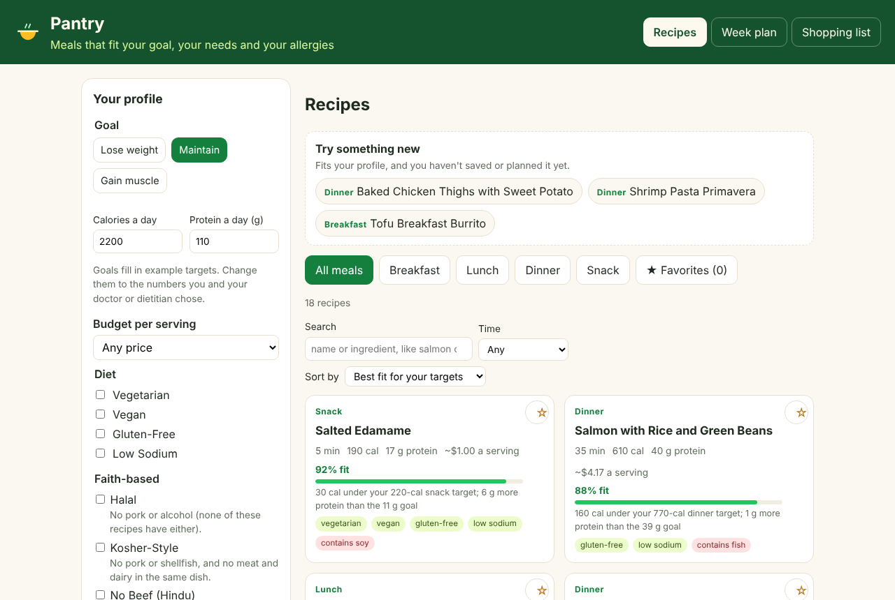
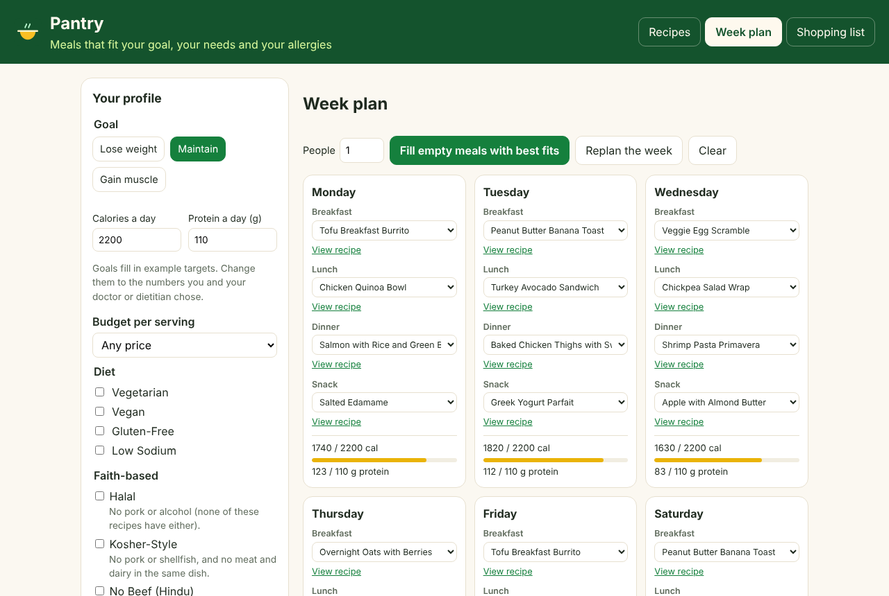
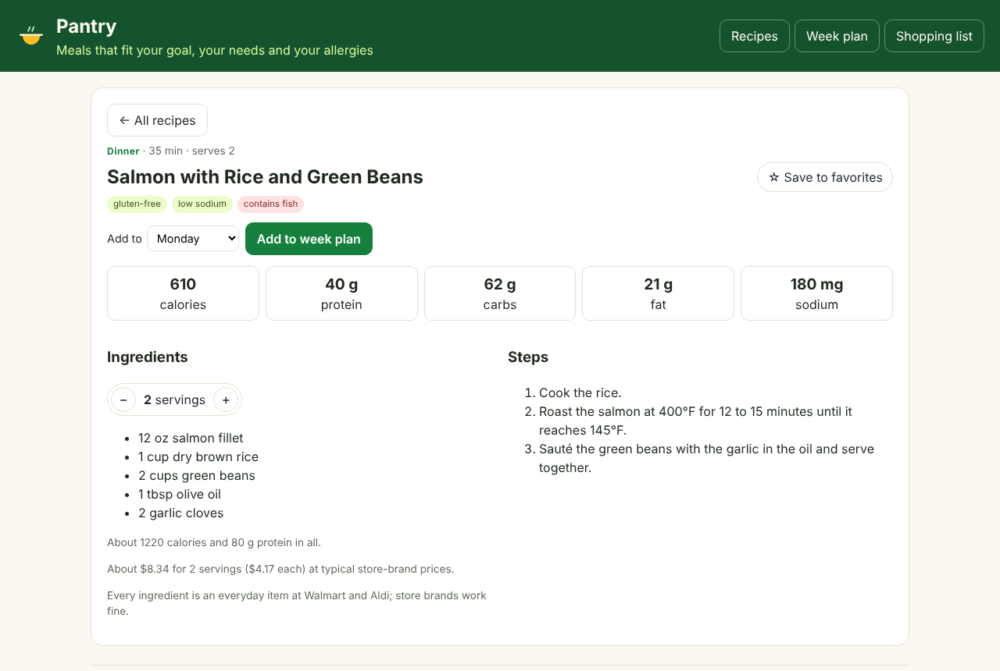
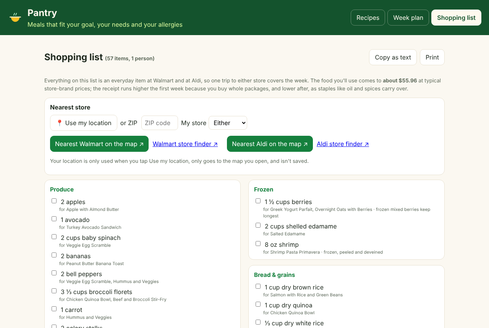

# 🥘 Pantry

A React meal planner that chooses recipes for you. Tell it your goal, your nutrition needs, your budget, any allergies and any faith-based diet, and it plans meals that fit, from everyday ingredients you can buy at Walmart or Aldi.

**Try it:** https://theoyanvno.github.io/pantry/



## Features

- **Your profile:** a goal (lose weight, maintain or gain muscle) that fills in example calorie and protein targets you can change, diet choices (vegetarian, vegan, gluten-free, low sodium) and nine allergies and intolerances.
- **Faith-based diets:** halal, kosher-style, no beef (Hindu), Orthodox fasting (no meat, fish, dairy or eggs; shellfish allowed) and meatless days for Lent, worked out from what each recipe is made of, with notes where it matters (buy halal meat, kosher-certified meat and cheese, skipping oil on strict fast days). Pantry leaves out what a tradition forbids; it can't certify food.
- **Allergies hide recipes:** any recipe with milk, eggs, fish, shellfish, tree nuts, peanuts, wheat, soy or sesame you've marked is hidden, the page says how many were hidden, and allergens show in red on every recipe.
- **Shop at Walmart or Aldi:** every recipe uses only everyday ingredients both stores carry (store brands work fine), so a week's list fits one trip to either.
- **Best fit first:** 18 recipes for breakfast, lunch, dinner and snacks, ranked by how close each comes to your calorie and protein targets for that meal, with a percent and a plain reason ("140 cal under your 660-cal lunch target").
- **Budget:** an estimated cost per serving on every recipe (typical Walmart and Aldi store-brand prices), a budget per serving in your profile, sorting by lowest cost, and the week's food cost on the plan and shopping list.
- **Favorites and new ideas:** star any recipe to save it and filter to your favorites, and Try something new suggests recipes that fit your profile that you haven't saved or planned yet, changing each day.
- **Search and filter:** by name or ingredient (every word must match), by meal and by time (10, 20 or 30 minutes or less).
- **Recipes that scale:** change the servings and every amount updates, with fractions kept readable (1 ½ cups, not 1.5), plus calories, protein, carbs, fat and sodium per serving.
- **Week plan:** pick a recipe for each meal of each day, or fill the empty meals with the best fits for your profile in one click. Each day shows its calories and protein against your targets. Add any recipe to the plan from its page.
- **Shopping list:** every ingredient in the week, scaled to the number of people, added up by item and grouped by store aisle, with tick boxes, copy as text and a print layout.
- **Works on phones:** on a small screen the profile folds to one line ("Maintain · 2,200 cal · 110 g protein · no peanuts") with an Edit button, so the recipes come first.
- **Nearest Walmart or Aldi:** on the shopping list, tap Use my location (or type a ZIP code) to open the closest stores on a map, pick your store, or jump to each chain's store finder. Your location is only used when you tap, only goes to the map you open, and is never saved.
- **Saved in the browser:** your profile, favorites, store and week plan stay put between visits. Nothing to sign up for.

| Week plan | Recipe | Shopping list |
| --- | --- | --- |
|  |  |  |

## Run it

```bash
npm install
npm start      # build and serve at http://localhost:8000
npm test       # Node's test runner
npm run build  # build into docs/ for GitHub Pages
```

## Built with

React, JavaScript, esbuild, Node's test runner, GitHub Pages

## Note

Pantry is a planning tool, not medical or dietary advice. Always read food labels and check with a doctor or dietitian about allergies and nutrition needs.

## Credits

Built with help from AI coding tools; every feature is reviewed and tested before it ships.

## License

MIT. See [LICENSE](LICENSE).
